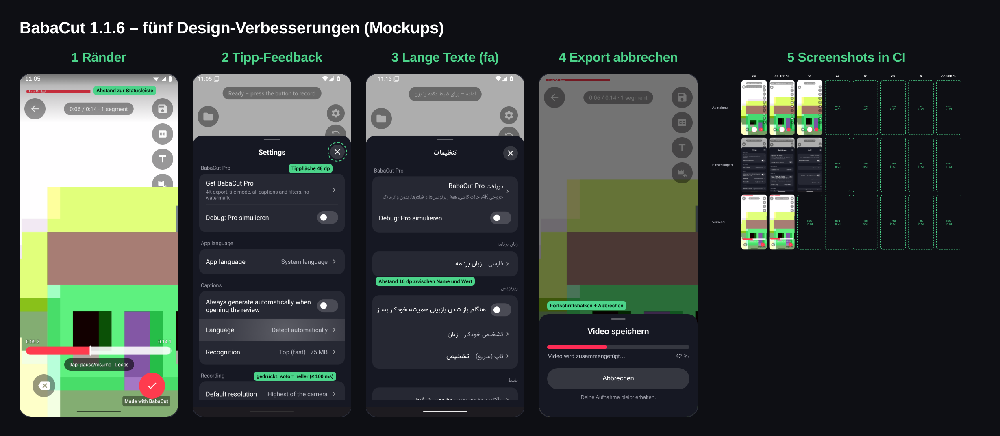
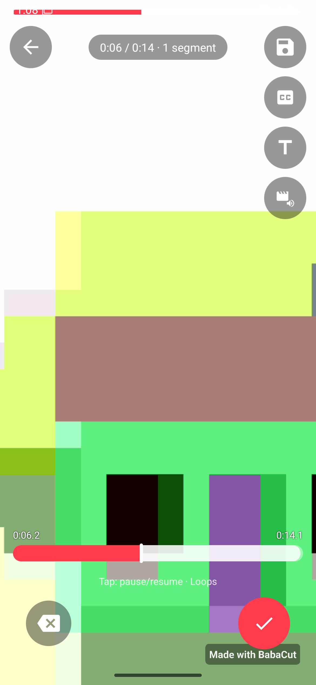
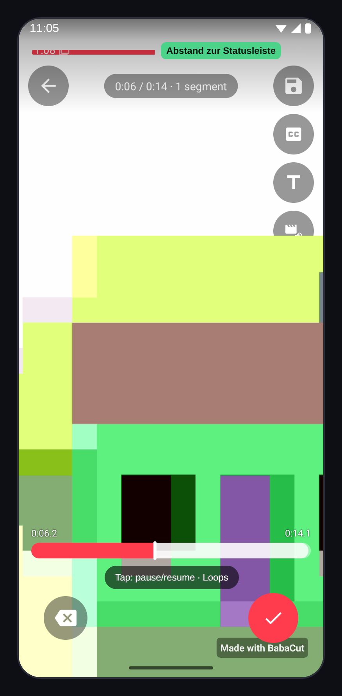
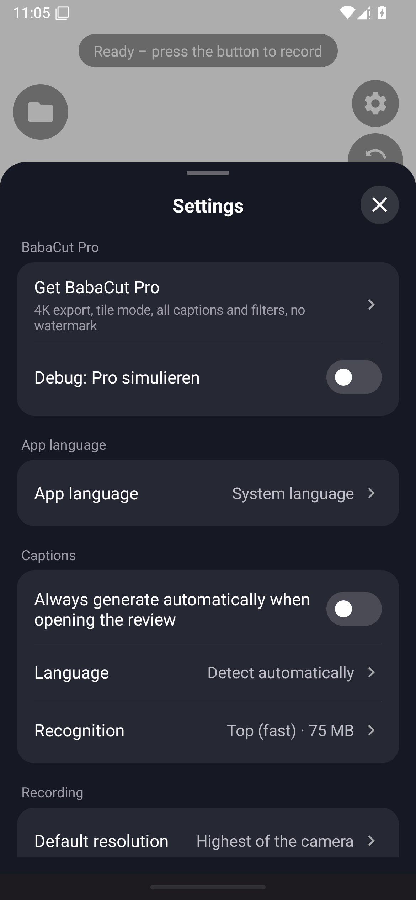
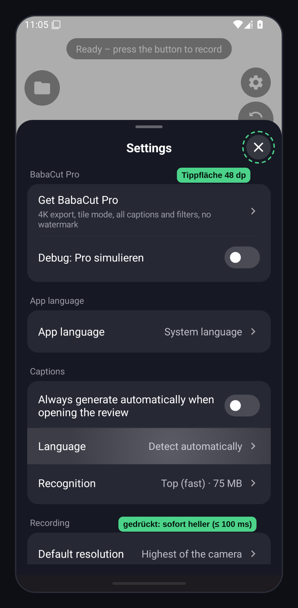
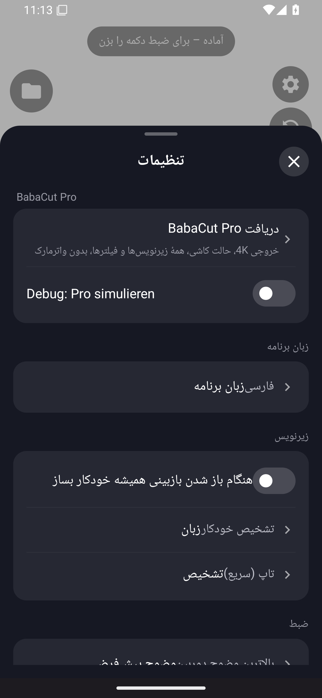
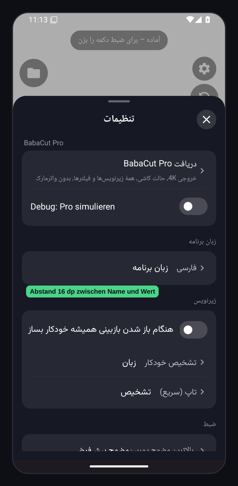
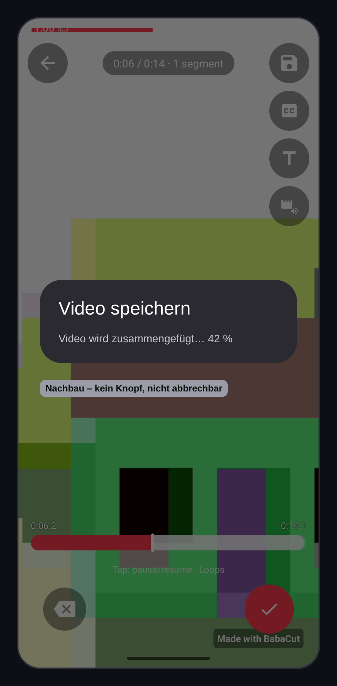
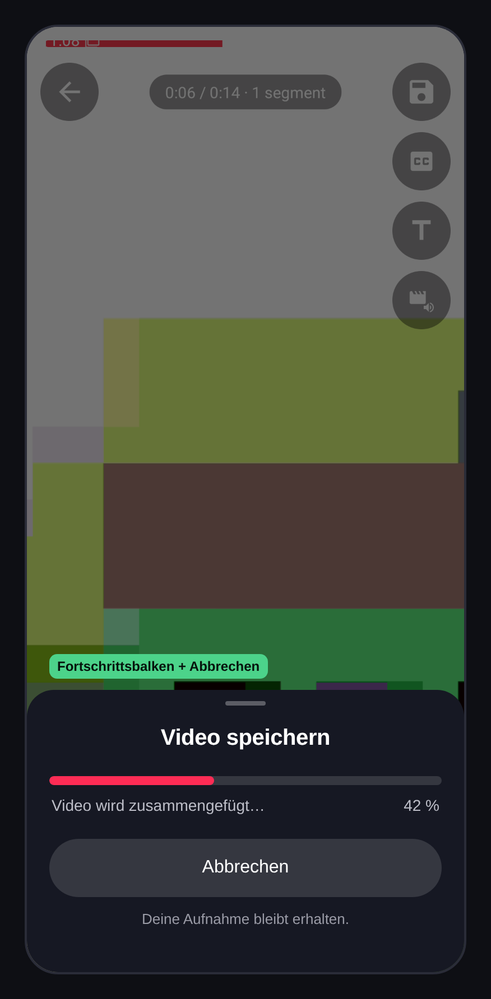
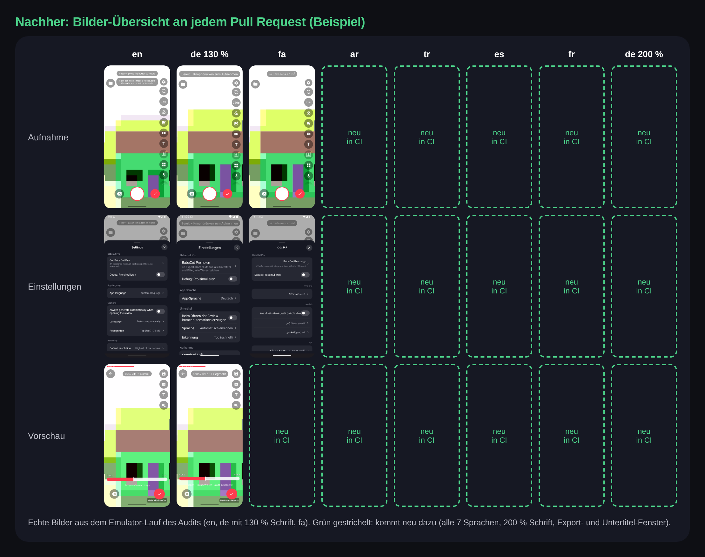

# Concept: BabaCut 1.1.6 – five design improvements (design polish)

Task `277c2965` (2026-11-13), concept only – **no file under `app/` was changed**. Author: `video-editor-entwickler`
(g46). Source: [design audit 2026-11](../design/DESIGN-AUDIT-2026-11.md) (task `9defaf40`), "Top 5 improvements",
hub task proposals `d3bf1d65`, `6e53b97d`, `5b1362db`, `067dc3c3`, `5cf6cd1c`.

Status: **waiting for the owner's decision `concept.approval`** (card draft at the end). Nothing is built before that,
except what the owner's rule "bugs are fixed right away" (hub knowledge #1781) allows – see "Bundling".

Owner-facing parts are in German (rule: everything addressed to the owner is German); technical notes in English.

## Kurz für den Owner

BabaCut sieht schon einheitlich aus. Was fehlt, sind Kleinigkeiten, die man **beim Bedienen** spürt: Auf neuen
Android-Handys (15/16, auch Ihr Xiaomi) rutscht die Leiste oben unter die Uhrzeit, ein Tippen zeigt keine Reaktion,
lange Übersetzungen kleben zusammen oder werden abgeschnitten, und der Export lässt sich nicht abbrechen.

Der Kern von BabaCut ist **„schneiden während der Aufnahme, nicht danach“**. Dafür muss die Aufnahme-Ansicht
schnell und sicher sein: Man tippt mit einer Hand, schnell, oft draußen bei hellem Licht. Jede der fünf Verbesserungen
macht genau diesen Moment ruhiger. Keine davon ändert, was die App kann – nur, wie sicher sie sich anfühlt.

| # | Verbesserung | Art | Aufwand | Risiko | Vorschlag |
|---|--------------|-----|---------|--------|-----------|
| 1 | Ränder auf Android 15/16 (Statusleiste, Kamera-Loch, Navigationsleiste) | **Sichtbarer Fehler** (A1) + kleiner Design-Teil (A20) | M (1–2 Tage) | mittel | 1.1.6 |
| 2 | Sofortige Reaktion beim Tippen + größere Tippflächen | Design-Änderung (A2, A6, A7) | S–M (½–1½ Tage) | niedrig | 1.1.6 |
| 3 | Lange Übersetzungen und Persisch/Arabisch-Abstände | **Sichtbarer Fehler** (A19, A3) + Design (A4, A10, A11) | S (½ Tag) | niedrig | 1.1.6 |
| 4 | Export abbrechen können, mit Fortschrittsbalken | Design-Änderung / neues Verhalten (A5, A16) | M (1–2 Tage) | mittel | 1.1.7 (oder 1.1.6, wenn Sie es zusammen wollen) |
| 5 | Automatische App-Screenshots in der Build-Prüfung (CI) | Keine sichtbare Änderung (Werkzeug) | M (1–2 Tage) | niedrig (nur CI) | sofort, parallel, kein Versionssprung |

Aufwand: S ≤ ½ Tag, M ≈ 1–2 Tage Agentenzeit inkl. CI (wie im Audit). Version 1.1.5 (versionCode 84) bleibt
unverändert; alles hier kommt frühestens in **1.1.6 / versionCode 85** (hub knowledge #1715).

---

## 1 – Ränder auf Android 15/16 (edge-to-edge insets) · `d3bf1d65`

**Problem (für den Owner):** Seit Android 15 zeichnet jede App bis ganz an den Bildschirmrand. BabaCut weiß das noch
nicht: Der rote Segmentbalken liegt unter der Uhrzeit, der Zurück-Knopf rückt ans Kamera-Loch, und auf hellem Video
verschwinden die weißen Symbole oben. Mit 3-Tasten-Navigation können Aufnahme- und Speichern-Knopf unten mit den
Systemtasten kollidieren. Ihr Handy (Android 16) und die Prüfgeräte von Google sind genau diese Klasse.

**Bezug zur Kernidee:** Der Segmentbalken ist das Werkzeug, mit dem man *während* der Aufnahme schneidet. Er muss
immer frei sichtbar und greifbar sein.

| Vorher | Nachher (Mockup) |
|--------|------------------|
|  |  |

Vergleich mit Erklärung: [01-insets-vergleich.png](assets/2026-11-13-design-polish/01-insets-vergleich.png).
Weitere Vorher-Bilder: [`api35-en-01-record-idle.png`](../design/screenshots/app/api35-en-01-record-idle.png),
[`api35-en-10-review-text.png`](../design/screenshots/app/api35-en-10-review-text.png); zum Vergleich Android 14
(noch schwarze Statusleiste): [`api34-en-01-record-idle.png`](../design/screenshots/app/api34-en-01-record-idle.png).

**Lösung:** Das Video bleibt Vollbild. Nur die Bedienelemente rücken um die Höhe der Statusleiste (oben) und der
Navigationsleiste (unten) nach innen. Oben liegt ein leichter dunkler Verlauf, damit Uhrzeit, Segmentbalken und
Hinweise auch auf hellem Video lesbar bleiben; der Hinweis „Tippen: Pause/Weiter“ bekommt einen dunklen Hintergrund
(A20).

**Technical:** `WindowCompat.enableEdgeToEdge` (or `enableEdgeToEdge()` from activity 1.8+) in `MainActivity`;
`ViewCompat.setOnApplyWindowInsetsListener` on the root of `activity_main.xml` and `view_review.xml`, applying
`systemBars() or displayCutout()` as padding/margin to the top bar, right rail and bottom controls (not to the
`PreviewView`/`PlayerView`). Sheets (`Sheet.kt`) get the bottom inset as extra padding. Top scrim: a 120dp gradient
drawable behind the top controls; review hint gets a `#99000000` rounded background. Light/dark status-bar icons
stay light (`isAppearanceLightStatusBars = false`) because of the scrim. Evidence: `app/build.gradle.kts:14`
(`targetSdk 36`), `themes.xml:3-4`, `activity_main.xml:31`, `:390`, `view_review.xml:186`, no `WindowInsets`
handling anywhere (audit A1).

**Aufwand:** M. **Risiko:** mittel – betrifft alle Hauptansichten; Fehler wären doppelte Abstände oder Knöpfe unter der
Navigationsleiste auf älteren Geräten (API 26–34). Abgesichert durch Screenshots auf API 34 und 35 (Verbesserung 5)
und Ihren Test auf dem Xiaomi.

**Einordnung:** **Sichtbarer Fehler (A1, auf dem Emulator bestätigt)** – darf nach Ihrer Regel direkt behoben werden.
Der Verlauf und der Hinweis-Hintergrund (A20) sind eine kleine Design-Änderung und Teil dieser Freigabe.

---

## 2 – Sofortige Reaktion beim Tippen + 48-dp-Tippflächen · `6e53b97d`

**Problem (für den Owner):** Wenn man einen runden Knopf, eine Zeile oder eine Pro-Karte antippt, passiert sichtbar
nichts, bis sich das nächste Fenster öffnet. Das fühlt sich langsam an, obwohl die App schnell ist. Einige Knöpfe
sind kleiner als die von Android empfohlenen 48 dp (Schließen-X nur 36 dp, Einstellungen/Kachel/Overlay 44 dp), man
trifft sie leichter daneben. Während der Aufnahme sind manche Knöpfe nur blass – tippt man sie an, passiert still
nichts.

**Bezug zur Kernidee:** Beim Schneiden während der Aufnahme tippt man schnell und mit einer Hand. Jeder Tipp muss
sofort „Ja, angekommen“ sagen, sonst tippt man doppelt.

| Vorher | Nachher (Mockup) |
|--------|------------------|
|  |  |

Vergleich mit Zustands-Detail (Ruhe / gedrückt / gesperrt, Mindestgrößen):
[02-tippfeedback-vergleich.png](assets/2026-11-13-design-polish/02-tippfeedback-vergleich.png). Vorher-Bild mit blassen
Knöpfen während der Aufnahme: [`api35-en-07-recording.png`](../design/screenshots/app/api35-en-07-recording.png).

**Lösung:** Beim Aufsetzen des Fingers wird ein Knopf sofort etwas heller und minimal kleiner, Zeilen hellen auf
(Android-Ripple, 100–160 ms). Alle Tippflächen mindestens 48 dp – die sichtbare Größe bleibt, nur die Fläche um den
Knopf wächst. Knöpfe, die während der Aufnahme nicht gehen, sind wirklich gesperrt; tippt man trotzdem, erscheint
kurz „Während der Aufnahme nicht verfügbar“ (neuer Text in allen 7 Sprachen).

**Technical:** `RippleDrawable` (mask = existing shape) for `bg_round_button.xml`, `bg_round_button_accent.xml`,
`bg_pill.xml`; `?selectableItemBackground` foreground on `SheetRows.rowBase` and Pro cards (`MainActivity.kt:911-918`,
`:1198-1206`); optional `StateListAnimator` scale 0.96 at 100 ms (respects animator duration scale). Touch targets:
`Sheet.kt:83` close X 36→48dp (`TouchDelegate` or padding), `activity_main.xml:84`, `:227`, `:256-371` 44→48dp,
mosaic line item `MainActivity.kt:1212`. Disabled state: `isEnabled = false` instead of `alpha 0.35`
(`MainActivity.kt:3259-3262`, `:641`, `:684`) plus one new string `not_while_recording` in all 7 `strings.xml`
(FA/AR go to the owner's proofreading list).

**Aufwand:** S–M. **Risiko:** niedrig – reine Darstellung; einzig die größeren Tippflächen der rechten Leiste müssen
geprüft werden, damit die Leiste nicht weiter nach unten scrollt (A21).

**Einordnung:** Design-Änderung – braucht Ihre Freigabe.

---

## 3 – Lange Übersetzungen und Persisch/Arabisch-Abstände · `5b1362db`

**Problem (für den Owner):** Auf Persisch kleben in den Einstellungen Name und Wert zusammen: „فارسیزبان برنامه“ statt
„زبان برنامه“ + „فارسی“; ein Text stößt direkt an den Schalter. Arabisch ist vermutlich gleich. Auf Französisch wird
der Hinweis „zum Umordnen ziehen“ über dem Segmentbalken an beiden Enden abgeschnitten. Lange Texte im Status-Feld
der Vorschau können die Nachbarknöpfe verdecken, und der Text im Segmentbalken wächst nicht mit der
System-Schriftgröße.

**Bezug zur Kernidee:** Umordnen per Ziehen ist die wichtigste Schnitt-Geste während der Aufnahme – ihr Hinweis muss
in allen 7 Sprachen ganz lesbar sein. Die persische Gemeinschaft ist eine Kernzielgruppe.

| Vorher | Nachher (Mockup) |
|--------|------------------|
|  |  |

Vergleich mit Erklärung: [03-lange-texte-fa-vergleich.png](assets/2026-11-13-design-polish/03-lange-texte-fa-vergleich.png).
(Schrift im Mockup: Vazirmatn als Näherung; die App nutzt die System-Schrift.)

**Lösung:** 16 dp Abstand zwischen Name und Wert, 12 dp zwischen Text und Schalter. Die App bleibt bewusst
links-nach-rechts (`supportsRtl=false`, Ihre Entscheidung) – nur die Abstände ändern sich. Der Ziehen-Hinweis bekommt
eine Breitengrenze und bricht um bzw. kürzt mit „…“; das Status-Feld bekommt eine Höchstbreite; Texte im Segmentbalken
folgen der System-Schriftgröße; das „720p“-Feld verkleinert seine Schrift bei sehr großer Systemschrift.

**Technical:** `SheetRows.kt` `choice()`: `value` gets `marginStart = 16dp`; `switch()`: label box `marginEnd = 12dp`
(`SheetRows.kt:53`, `:83-85`). `ScrubBarView.kt:161-162`: `StaticLayout` with width = bar width − 32dp, max 2 lines,
`TextUtils.TruncateAt.END`; `ScrubBarView.kt:74` text size via `TypedValue.applyDimension(COMPLEX_UNIT_SP, 12f, …)`.
`view_review.xml:121-133` status pill: `app:layout_constrainedWidth="true"` between back and save-draft,
`maxLines=1`, `ellipsize=end`. `activity_main.xml:126-136` quality label: `autoSizeTextType="uniform"`. No new strings.

**Aufwand:** S. **Risiko:** niedrig – nur Abstände und Textumbruch; geprüft an fa/ar/fr/de-Screenshots mit 130 % und
200 % Schrift (Verbesserung 5).

**Einordnung:** **Sichtbarer Fehler (A19 auf dem Emulator bestätigt; A3 aus dem Code)** – direkt behebbar. A4, A10,
A11 sind kleine Design-Anpassungen derselben Art und laufen mit.

---

## 4 – Export abbrechen, mit Fortschrittsbalken · `067dc3c3`

**Problem (für den Owner):** Beim Speichern erscheint ein Fenster mit „Video wird zusammengefügt… 42 %“. Es hat keinen
Knopf und lässt sich nicht schließen. Hat man die falsche Qualität gewählt, wartet man bei langen Videos mehrere
Minuten. Dasselbe gilt für das Umwandeln eines eingefügten Videos. Das Fenster ist außerdem ein Android-Standardfenster
und sieht anders aus als der Rest von BabaCut.

**Bezug zur Kernidee:** Wer schon während der Aufnahme geschnitten hat, soll danach nicht in einer Warteschleife
festsitzen. Der Export ist die einzige Wartezeit – sie muss jederzeit verlassbar sein.

| Vorher (Nachbau) | Nachher (Mockup) |
|------------------|------------------|
|  |  |

Hinweis: Das Export-Fenster wurde im Emulator-Lauf des Audits **nicht** fotografiert (siehe Audit, „Not captured“).
Das Vorher-Bild ist ein Nachbau nach dem Code (`MainActivity.kt:2808-2812`, `setCancelable(false)`, Text-Prozent);
Hintergrund ist das echte Vorschau-Bild [`api35-en-09-review.png`](../design/screenshots/app/api35-en-09-review.png).

**Lösung:** Ein BabaCut-Fenster im Stil der anderen Fenster (dunkel, abgerundet, Griff oben): Titel, roter
Fortschrittsbalken, Prozentzahl, großer Knopf „Abbrechen“ und der Satz „Deine Aufnahme bleibt erhalten.“ Abbrechen
stoppt nur den Export; Segmente, Texte und Entwurf bleiben unverändert, die halbfertige Datei wird gelöscht. Keine
Restzeit-Schätzung (wir können sie nicht verlässlich berechnen).

**Technical:** Replace the `MaterialAlertDialogBuilder` in `runExport` (`MainActivity.kt:2808-2812`) and the
conversion dialog (`:1315-1319`, `:1554`) with a `Sheet` containing a `LinearProgressIndicator` (accent `#FE2C55`,
also resolves A16's second red) and a cancel button. Correction to the audit (A5): `Exporter` has **no** public
`cancel()` yet – only `release()` (`Exporter.kt:321-325`), which cancels the Media3 `Transformer` and shuts the worker
down (single use, called from `onDestroy`, `MainActivity.kt:3315`). The task adds `Exporter.cancel()`: cancel the
`Transformer`, mark the run as cancelled so its `onError` is not shown as an error, and stop before the next step
if the pre-render (`renderMixWav`, overlay-sound mix) is still running; on cancel:
delete the partial output, restore the review player (it is released before export at `:2815-2818`), re-enable
controls, show a short "Export abgebrochen" status. Back key = cancel with the same path. New strings
(`export_cancel_hint`, `export_cancelled`) in all 7 `strings.xml`. Unit test for the cancel state machine where it
can be extracted; Media3 `Transformer.cancel()` behaviour is checked on the device.

**Aufwand:** M. **Risiko:** mittel – Abbrechen mitten im Media3-Export muss Dateien und Player sauber aufräumen; ein
Fehler hier könnte die Vorschau nach dem Abbrechen schwarz lassen. Kein Risiko für die Aufnahme selbst (die Segmente
werden beim Export nur gelesen). Deshalb Vorschlag als eigenes kleines Update 1.1.7, wenn Sie lieber kleine Schritte
wollen.

**Einordnung:** Design-Änderung / neues Verhalten – braucht Ihre Freigabe.

---

## 5 – App-Screenshots automatisch in der Build-Prüfung (CI) · `5cf6cd1c`

**Problem (für den Owner):** Ob ein Knopf in Türkisch abgeschnitten ist oder Persisch zusammenklebt, sehen wir heute
nur auf Ihrem Handy oder durch einen einmaligen Emulator-Lauf. Fünf der Audit-Punkte sind deshalb nur „plausibel“,
nicht bewiesen.

**Bezug zur Kernidee:** Die Aufnahme-Ansicht ist das Herz der App. Mit Bildern bei jedem Pull Request sehen wir in allen
7 Sprachen und bei großer Schrift, ob sie noch stimmt – bevor eine Version zu Ihnen kommt.

**Vorher:** keine automatischen Bilder; nur der einmalige Lauf des Audits (z. B.
[`api35-de130-01-record-idle.png`](../design/screenshots/app/api35-de130-01-record-idle.png)).

**Nachher (Mockup):** An jedem Pull Request hängt eine Bilder-Übersicht – Aufnahme, Einstellungen, Vorschau, Export
und Untertitel in en/de/tr/es/fr/fa/ar plus 130 % und 200 % Schrift. Im Mockup sind die vorhandenen Audit-Bilder
echt, grün gestrichelt ist, was neu dazukommt:

**Technical:** Two options, decided in the implementation task, not here:
(a) JVM screenshot tests (Roborazzi + Robolectric) for views/sheets – fast, no emulator, but CameraX/Media3 views need
fakes; (b) the audit's emulator script (API 35, 390×844 dp, `cmd locale set-app-locales`, font scale) as a CI job
on `workflow_dispatch` + label, artefact upload only. Both only touch `app/src/test` / `.github/workflows` and need
**no versionCode bump**. A new workflow file is a protected path → owner merge (hub: Freigabe-Agent, CI green).
Cost: emulator minutes on GitHub Actions (public repo: free runners); a cap is not needed for the JVM variant.

**Aufwand:** M. **Risiko:** niedrig – keine Änderung an der App; schlimmstenfalls ein langsamer oder wackliger CI-Job
(deshalb nur auf Anfrage/Label, nicht bei jedem Push).

**Einordnung:** Keine sichtbare Änderung (Werkzeug/Test) – braucht nach den Regeln kein Konzept, steht hier für die
Reihenfolge.

---

## Reihenfolge und Bündelung (Vorschlag)

1. **Sofort, parallel: 5 (Screenshots in CI).** Kein App-Update. Liefert die Bilder, mit denen 1–4 geprüft werden.
2. **1.1.6 / versionCode 85 – ein Build, ein Test auf Ihrem Handy:**
   - **1 Ränder** (Fehler A1) und **3 Abstände/lange Texte** (Fehler A19, A3) – nach Ihrer Regel „Fehler sofort“
     dürfen diese beiden auch ohne Konzept-Freigabe starten; die Design-Anteile (A20, A4, A10, A11) kommen mit Ihrer
     Freigabe dazu.
   - **2 Tipp-Feedback** – mit Ihrer Freigabe; klein, niedriges Risiko, passt in denselben Test.
3. **1.1.7 / versionCode 86: 4 Export abbrechen** – eigenes kleines Update, weil es das einzige Teil mit Datei- und
   Player-Logik ist. Alternative: mit in 1.1.6, wenn Sie lieber ein größeres Update wollen.

Begründung: Sie bevorzugen kleine Updates zuerst (1.1.4-Entscheidung) und trennen Fehlerbehebung von Design
(hub knowledge #1781). 1.1.5 bleibt unverändert (versionCode 84, Tag `v1.1.5` durch Sie).

Jedes Teil wird ein eigener Pull Request; versionCode 85 setzt nur der erste PR, der in 1.1.6 landet.

## Design rules applied

Read from `.claude/skills/` for this task: `apple-design`, `ui-cheatsheet`.

- **apple-design §1 Response / §10 Tap** ("highlight on touch-down, commit on touch-up") → improvement 2 (ripple on
  press, ≤ 100 ms).
- **apple-design §16 Wayfinding** ("never trap the user"; feedback kinds status/completion) → improvement 4 (cancel,
  progress, "Aufnahme bleibt erhalten").
- **apple-design §16 Agency / forgiveness** → cancel keeps all segments; no confirmation dialog for cancel (it is not
  destructive).
- **apple-design §12 Vibrancy / scroll edge effects** (gradient instead of hard bar where chrome overlaps content) →
  improvement 1 (top scrim instead of an opaque status bar, video stays full screen).
- **apple-design §15 Respect the text-size setting** → improvement 3 (sp text in the scrub bar, auto-size quality label).
- **apple-design §14 Reduced motion** → press scale uses the animator duration scale; no new slides.
- **apple-design §16 Flexibility / Craft** (inclusive of language) → improvement 3 and 5 (7 languages, 200 % font).
- **ui-cheatsheet "Button feels unresponsive → scale(0.97) on :active"** → Android equivalent scale 0.96 +
  ripple (improvement 2).
- **ui-cheatsheet "Numbers jitter → tabular-nums"** → export percentage uses tabular figures (improvement 4).
- **ui-cheatsheet "Dropdown sluggish → ease-out under 300 ms"** → all new state changes ≤ 160 ms.
- Android translations (from the audit): 48dp touch target (mobile-native baseline), insets (mobile-native #7, #10).
  `review-animations`, `break-ui` and `mobile-native` are not in this clone; their rules are cited from the audit.

## Mockups – how they were made

Playwright (Chromium headless shell) rendered HTML pages at 390×844 CSS px (= the emulator's 390×844 dp, device
scale 2). Each "Nachher" image is the **real emulator screenshot** from `docs/design/screenshots/app/` with drawn
overlays (status-bar scrim, shifted top band, row highlight, re-set fa row text, new export sheet). Test data only (the
emulator's synthetic camera scene). They are approximations, not app builds: exact colours, fonts and positions are
decided in the implementation and checked with real screenshots (improvement 5). This task wrote nothing into
`docs/design/screenshots/` (owned by the screenshot task) – it only reads that folder.

Files in [`assets/2026-11-13-design-polish/`](assets/2026-11-13-design-polish/): `00-uebersicht.png`,
`0N-*-nachher.png` (single phone), `0N-*-vergleich.png` (before | after with notes), `05-screenshots-ci-nachher.png`.

## Decision draft `concept.approval` (for the planner; not sent by this task)

The task brief says the planner asks the owner at the checkpoint, so this card is prepared, not posted.

- **type:** `concept.approval` · **project:** BabaCut (`video-editor`) · `content_approval: true` ·
  `requires_owner_action: false` (the owner only answers; no manual step)
- **preview.image_url:**
  `https://raw.githubusercontent.com/codinix8/video-editor/agent/277c2965-babacut-concept-five-design-improvements/docs/concepts/assets/2026-11-13-design-polish/00-uebersicht.png`
  (after merge: same path on `main`)
- **preview.url:**
  `https://github.com/codinix8/video-editor/blob/agent/277c2965-babacut-concept-five-design-improvements/docs/concepts/2026-11-13-design-polish-1-1-6.md`
- **Text (German, full):**

> **BabaCut: fünf Design-Verbesserungen für 1.1.6 – Freigabe?**
>
> Aus dem Design-Audit vom 12.11. haben wir fünf Verbesserungen als Bilder vorbereitet (vorher = echtes Emulator-Bild,
> nachher = Mockup). Alle machen die Aufnahme-Ansicht ruhiger und sicherer – passend zu „schneiden während der
> Aufnahme“. Version 1.1.5 bleibt unverändert.
>
> 1. **Ränder auf Android 15/16** – oben rutscht der Segmentbalken unter die Uhrzeit (Fehler). Aufwand 1–2 Tage.
> 2. **Sofortige Reaktion beim Tippen + größere Tippflächen** – Design. Aufwand ½–1½ Tage.
> 3. **Persisch/Arabisch-Abstände und lange Übersetzungen** – „فارسیزبان برنامه“ klebt zusammen (Fehler). ½ Tag.
> 4. **Export abbrechen können** – mit Fortschrittsbalken, Aufnahme bleibt erhalten. 1–2 Tage.
> 5. **Automatische App-Screenshots bei jedem Pull Request** – kein App-Update, nur Prüfwerkzeug. 1–2 Tage.
>
> Vorschlag: 5 sofort; 1 + 2 + 3 zusammen als 1.1.6 (ein Test auf Ihrem Handy); 4 danach als 1.1.7.
> Die Fehler 1 und 3 würden wir nach Ihrer Regel auch ohne diese Freigabe beheben.

- **Options:**
  1. **„Alles wie vorgeschlagen freigeben“** (recommended) – 5 sofort, 1.1.6 = 1+2+3, 1.1.7 = 4.
  2. **„Alles in 1.1.6“** – 1, 2, 3 und 4 in einem Update.
  3. **„Nur Fehler beheben (1 + 3), Design später“** – 2 und 4 warten; 5 trotzdem.
  4. **„Einzeln entscheiden“** – je Verbesserung Ja / Nein / Später (1 Ränder, 2 Tippen, 3 Texte, 4 Export,
     5 Screenshots).
  5. **„Eigene Antwort“** – Freitext, Screenshot oder Sprachnachricht; geht an `video-editor-entwickler`.

After approval: the five hub tasks `d3bf1d65`, `6e53b97d`, `5b1362db`, `067dc3c3`, `5cf6cd1c` carry
"concept approved: <decision id>" in their briefs.
